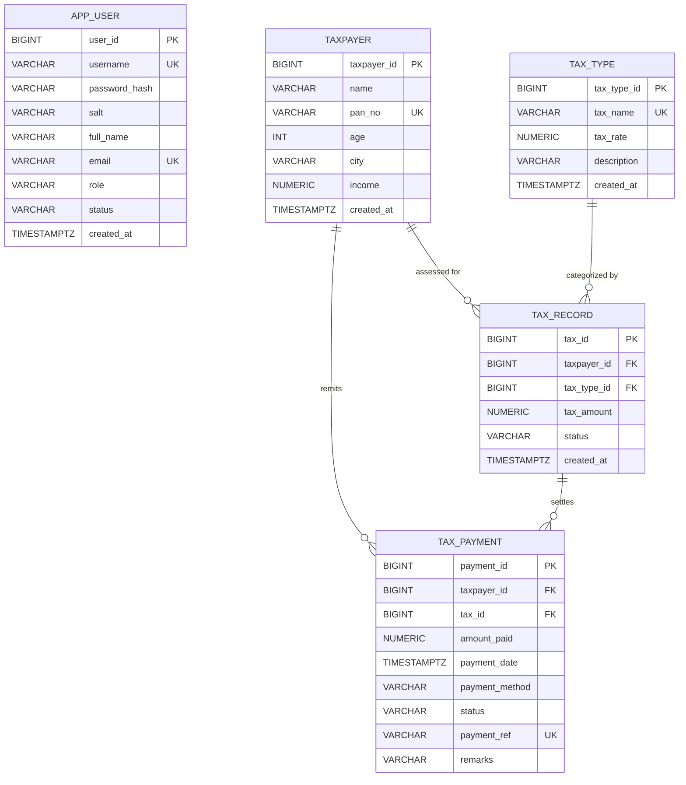

# FISCAL — Cloud-Native SQL Tax Management System

[](https://render.com)
[-3ECF8E?style=for-the-badge&logo=supabase&logoColor=white)](https://supabase.com)
[](https://www.postgresql.org/)
[](https://openjdk.org/)
[](https://www.docker.com/)
[](https://chennai.vit.ac.in/)

> **Institutional Provenance:** Vellore Institute of Technology (VIT), Chennai Campus  
> **School:** School of Computer Science & Engineering (SCOPE)  
> **Course:** BACSE202 — Database Systems (DBMS) • Project-Based Learning (PAT)  
> **Faculty Guide & Mentor:** Prof. A SWAMINATHAN (Assistant Professor Senior Grade 2)  
> **Lead Developer & Architect:** Arpit Raj (B.Tech Computer Science & Engineering)  
> **Live Architecture:** 100% Cloud-Hosted (Render PaaS + Supabase Managed PostgreSQL)

---

## 1. Executive Summary

**FISCAL** is an enterprise-grade, cloud-native **SQL relational tax management system** engineered to replace fragile manual spreadsheets and legacy offline accounting scripts. Unlike traditional desktop or local-only classroom projects, FISCAL is architected as an **always-on, cloud-distributed platform**:

- **No Local Database Dependency:** FISCAL does **not** rely on a local database instance running on a developer laptop. The system operates on a managed, high-availability **Cloud PostgreSQL** database hosted on **Supabase** (AWS ap-northeast-1 / Tokyo region), accessible with SSL encryption (`sslmode=require`) through an enterprise connection pooler.
- **Cloud PaaS Orchestration:** Deployed as an automated multi-stage **Docker container on Render**, integrating continuous deployment (CI/CD) tracking the GitHub repository.
- **Relational SQL Integrity:** Built on authoritative ANSI SQL data definitions (DDL), referential integrity constraints, primary/foreign key cascading hierarchies, identity sequences, and ACID-compliant transactional state machines via JDBC `PreparedStatement`.
- **Editorial Matcha UI & 3D Cluster Visualizer:** Pairs a mathematical calculation engine (`BigDecimal` Half-Up rounding) with a bespoke Matcha & Milk Honey design system and a WebGL Three.js 3D database cluster visualizer.

---

## 2. Cloud Architecture vs. Local Setup

| Dimension | Legacy / Local Systems | FISCAL Cloud Architecture |
| :--- | :--- | :--- |
| **Database Host** | `localhost:1521` or `localhost:5432` (Fragile laptop daemon) | **Supabase Cloud Managed PostgreSQL** (AWS Multi-AZ Infrastructure) |
| **Application Host** | Local machine terminal / localhost server | **Render Cloud Platform** (Automated Linux Container) |
| **Network Routing** | Offline / Local loopback only | Global IPv4 Cloud Session Pooler with SSL Encryption (`sslmode=require`) |
| **High Availability** | Dies when laptop sleeps or closes | **24/7 Cloud Uptime** with automated health-checks and self-healing |
| **Deployment Flow** | Manual local builds | **Git Push to GitHub `main` &rarr; Automated Cloud Build & Deploy** |
| **Data Persistence** | Lost on local disk wipes | Multi-tenant cloud backups, continuous transaction write-ahead logging (WAL) |

---

## 3. High-Level Architectural Topology

```text
 ┌────────────────────────────────────────────────────────────────────────┐
 │                      CLIENT BROWSER (ANY DEVICE)                       │
 │  Semantic HTML5 + Vanilla CSS3 Tokens + Vanilla JS ES6+ + Three.js     │
 └────────────────────────────────────┬───────────────────────────────────┘
                                      │ HTTPS / JSON REST APIs
                                      ▼
 ┌────────────────────────────────────────────────────────────────────────┐
 │                     RENDER CLOUD CONTAINER (PAAS)                      │
 │                  Docker Multi-Stage Runtime (Linux Alpine)             │
 │                                                                        │
 │  [Embedded Servlet Gateway / FiscalDevServer]                          │
 │   ├── CharacterEncodingFilter (UTF-8, Security Headers, CORS)          │
 │   └── AuthenticationFilter (Session Verification, RBAC Roles)          │
 │                                                                        │
 │  [RESTful Servlets]                                                    │
 │   ├── /api/auth/*               (PBKDF2 Hashing, Session Management)   │
 │   ├── /api/dashboard/summary    (Real-Time SQL Aggregate Queries)      │
 │   ├── /api/taxpayers/*          (CRUD, PAN Verification, Filtering)    │
 │   ├── /api/tax-types/*          (Statutory Rates & Rule Governance)    │
 │   ├── /api/tax/calculate        (BigDecimal Mathematical Engine)       │
 │   ├── /api/payments/*           (Ledger Records, Status Transitions)   │
 │   └── /api/users/*              (Role-Based Operator Governance)       │
 │                                                                        │
 │  [Authoritative JDBC Data Access Layer (DAO)]                          │
 │   └── 100% Parameterized SQL (PreparedStatement) + Atomic Transactions │
 └────────────────────────────────────┬───────────────────────────────────┘
                                      │ PostgreSQL Wire Protocol + TLS/SSL
                                      ▼
 ┌────────────────────────────────────────────────────────────────────────┐
 │               SUPABASE CLOUD POSTGRESQL (AWS TOKYO POOLER)             │
 │                      Direct / Session Pooler Port: 5432                │
 │                                                                        │
 │  [ANSI SQL Relational Schema (3NF)]                                    │
 │   ├── TAXPAYER      (Taxpayer Demographics & PAN Uniqueness)           │
 │   ├── TAX_TYPE      (Statutory Categories & Configurable Rates)        │
 │   ├── TAX_RECORD    (Assessment Ledger & Statutory Calculations)       │
 │   ├── TAX_PAYMENT   (Settlements, Audit Refs, Status State Machine)    │
 │   └── APP_USER      (RBAC Credentials, PBKDF2 Hashes & Crypt Salts)    │
 │                                                                        │
 │  [Relational Constraints & Integrity]                                  │
 │   ├── Primary Keys (BIGINT GENERATED ALWAYS AS IDENTITY)               │
 │   ├── Foreign Keys (ON DELETE CASCADE referential hierarchy)           │
 │   ├── Check Constraints (Income >= 0, Rates 0-100%, Age 18-120)        │
 │   └── Unique Indexes (PAN, Email, Username, Payment Reference)         │
 └────────────────────────────────────────────────────────────────────────┘
```

---

## 4. SQL Relational Database Specification (PostgreSQL)

FISCAL's foundation is built upon a normalized (3NF) relational SQL schema enforcing strict referential integrity, constraints, and auditability.

### 4.1 Relational Schema Diagram (Entity Relationship)



### 4.2 SQL Table Definitions

#### 1. `TAXPAYER` Table (Demographics & Statutory Identifier)
Stores taxpayer census and demographic information. Enforces unique government-issued Permanent Account Numbers (PAN).
```sql
CREATE TABLE TAXPAYER (
    TAXPAYER_ID  BIGINT GENERATED ALWAYS AS IDENTITY PRIMARY KEY,
    NAME         VARCHAR(100) NOT NULL,
    PAN_NO       VARCHAR(10)  NOT NULL UNIQUE,
    AGE          INT          NOT NULL CHECK (AGE >= 18 AND AGE <= 120),
    CITY         VARCHAR(50)  NOT NULL,
    INCOME       NUMERIC(14,2) NOT NULL CHECK (INCOME >= 0),
    CREATED_AT   TIMESTAMPTZ  DEFAULT NOW()
);

CREATE INDEX idx_taxpayer_city ON TAXPAYER(CITY);
CREATE INDEX idx_taxpayer_income ON TAXPAYER(INCOME);
```

#### 2. `TAX_TYPE` Table (Statutory Categories & Rates)
Maintains legal tax types and configured percentage rates.
```sql
CREATE TABLE TAX_TYPE (
    TAX_TYPE_ID  BIGINT GENERATED ALWAYS AS IDENTITY PRIMARY KEY,
    TAX_NAME     VARCHAR(50)  NOT NULL UNIQUE,
    TAX_RATE     NUMERIC(5,2) NOT NULL CHECK (TAX_RATE >= 0.00 AND TAX_RATE <= 100.00),
    DESCRIPTION  VARCHAR(255),
    CREATED_AT   TIMESTAMPTZ  DEFAULT NOW()
);
```

#### 3. `TAX_RECORD` Table (Tax Assessment Ledger)
Calculated statutory liabilities linking a specific taxpayer to a designated tax category.
```sql
CREATE TABLE TAX_RECORD (
    TAX_ID       BIGINT GENERATED ALWAYS AS IDENTITY PRIMARY KEY,
    TAXPAYER_ID  BIGINT         NOT NULL REFERENCES TAXPAYER(TAXPAYER_ID) ON DELETE CASCADE,
    TAX_TYPE_ID  BIGINT         NOT NULL REFERENCES TAX_TYPE(TAX_TYPE_ID) ON DELETE CASCADE,
    TAX_AMOUNT   NUMERIC(14,2)  NOT NULL CHECK (TAX_AMOUNT >= 0),
    STATUS       VARCHAR(20)    DEFAULT 'PENDING' CHECK (STATUS IN ('PAID', 'PENDING', 'REVERSED')),
    CREATED_AT   TIMESTAMPTZ    DEFAULT NOW()
);
```

#### 4. `TAX_PAYMENT` Table (Financial Settlements & Reconciliations)
Authoritative financial settlement audit trail with unique transaction reference codes.
```sql
CREATE TABLE TAX_PAYMENT (
    PAYMENT_ID     BIGINT GENERATED ALWAYS AS IDENTITY PRIMARY KEY,
    TAXPAYER_ID    BIGINT         REFERENCES TAXPAYER(TAXPAYER_ID) ON DELETE CASCADE,
    TAX_ID         BIGINT         REFERENCES TAX_RECORD(TAX_ID) ON DELETE CASCADE,
    AMOUNT_PAID    NUMERIC(14,2)  NOT NULL CHECK (AMOUNT_PAID >= 0),
    PAYMENT_DATE   TIMESTAMPTZ    DEFAULT NOW(),
    PAYMENT_METHOD VARCHAR(30)    DEFAULT 'NET_BANKING',
    STATUS         VARCHAR(20)    DEFAULT 'PAID' CHECK (STATUS IN ('PAID', 'PENDING', 'REVERSED')),
    PAYMENT_REF    VARCHAR(50)    NOT NULL UNIQUE,
    REMARKS        VARCHAR(255)
);

CREATE INDEX idx_payment_status ON TAX_PAYMENT(STATUS);
```

#### 5. `APP_USER` Table (Role-Based Access Control & PBKDF2 Credentials)
Stores authorized administrative and operator user profiles with cryptographic salts.
```sql
CREATE TABLE APP_USER (
    USER_ID       BIGINT GENERATED ALWAYS AS IDENTITY PRIMARY KEY,
    USERNAME      VARCHAR(50)  NOT NULL UNIQUE,
    PASSWORD_HASH VARCHAR(128) NOT NULL,
    SALT          VARCHAR(64)  NOT NULL,
    FULL_NAME     VARCHAR(100) NOT NULL,
    EMAIL         VARCHAR(100) NOT NULL UNIQUE,
    ROLE          VARCHAR(20)  DEFAULT 'OFFICER' CHECK (ROLE IN ('ADMIN', 'OFFICER', 'AUDITOR')),
    STATUS        VARCHAR(20)  DEFAULT 'ACTIVE' CHECK (STATUS IN ('ACTIVE', 'SUSPENDED')),
    CREATED_AT    TIMESTAMPTZ  DEFAULT NOW()
);
```

---

## 5. Key SQL Operations & Relational Queries

All database queries are executed via JDBC using strictly parameterized `PreparedStatement` to prevent SQL Injection vulnerabilities.

### 5.1 Real-Time Dashboard Aggregation (Multi-Table Joins & Grouping)
```sql
-- Total Revenue Collections vs. Pending Liabilities
SELECT 
    COUNT(p.PAYMENT_ID) AS TOTAL_PAYMENTS,
    COALESCE(SUM(CASE WHEN p.STATUS = 'PAID' THEN p.AMOUNT_PAID ELSE 0 END), 0) AS VERIFIED_REVENUE,
    COALESCE(SUM(CASE WHEN p.STATUS = 'PENDING' THEN p.AMOUNT_PAID ELSE 0 END), 0) AS PENDING_REVENUE
FROM TAX_PAYMENT p;
```

### 5.2 Category-Wise Tax Revenue Analysis
```sql
SELECT 
    t.TAX_NAME,
    t.TAX_RATE,
    COUNT(r.TAX_ID) AS ASSESSMENT_COUNT,
    COALESCE(SUM(p.AMOUNT_PAID), 0) AS TOTAL_COLLECTED
FROM TAX_TYPE t
LEFT JOIN TAX_RECORD r ON t.TAX_TYPE_ID = r.TAX_TYPE_ID
LEFT JOIN TAX_PAYMENT p ON r.TAX_ID = p.TAX_ID AND p.STATUS = 'PAID'
GROUP BY t.TAX_TYPE_ID, t.TAX_NAME, t.TAX_RATE
ORDER BY TOTAL_COLLECTED DESC;
```

### 5.3 Taxpayer Demographic Breakdown & Compliance Audit
```sql
SELECT 
    tp.TAXPAYER_ID,
    tp.NAME,
    tp.PAN_NO,
    tp.CITY,
    tp.INCOME,
    COUNT(p.PAYMENT_ID) AS PAYMENT_COUNT,
    COALESCE(SUM(p.AMOUNT_PAID), 0) AS TOTAL_REMITTED
FROM TAXPAYER tp
LEFT JOIN TAX_PAYMENT p ON tp.TAXPAYER_ID = p.TAXPAYER_ID
GROUP BY tp.TAXPAYER_ID, tp.NAME, tp.PAN_NO, tp.CITY, tp.INCOME
ORDER BY tp.TAXPAYER_ID ASC;
```

### 5.4 Atomic Transactional Integrity (Commit & Rollback)
When committing an assessment or reversing a payment, database transactions enforce ACID compliance:
```java
try (Connection conn = DatabaseConfig.getConnection()) {
    conn.setAutoCommit(false); // Begin Atomic Transaction Block
    
    // 1. Insert assessment record
    try (PreparedStatement psRecord = conn.prepareStatement(insertRecordSql, Statement.RETURN_GENERATED_KEYS)) {
        psRecord.setLong(1, taxpayerId);
        psRecord.setLong(2, taxTypeId);
        psRecord.setBigDecimal(3, taxAmount);
        psRecord.executeUpdate();
        // ... get generated key
    }
    
    // 2. Insert corresponding payment ledger transaction
    try (PreparedStatement psPayment = conn.prepareStatement(insertPaymentSql)) {
        psPayment.setLong(1, taxpayerId);
        psPayment.setLong(2, generatedTaxId);
        psPayment.setBigDecimal(3, taxAmount);
        psPayment.setString(4, paymentRef);
        psPayment.executeUpdate();
    }
    
    conn.commit(); // Atomic commit guaranteeing both or neither persist
} catch (SQLException ex) {
    conn.rollback(); // Rollback to pristine state upon any fault
    throw ex;
}
```

---

## 6. Mathematical Tax Engine

The calculation engine is implemented entirely on the server within [`TaxCalculationService.java`](src/main/java/com/fiscal/service/TaxCalculationService.java) to eliminate client-side tampering:

$$\text{Tax Amount} = \frac{\text{Applicable Amount} \times \text{Tax Rate}}{100}$$

- **Arbitrary Precision:** Implemented using `java.math.BigDecimal` with `RoundingMode.HALF_UP` scaled to 2 decimal places.
- **Zero Floating-Point Divergence:** Prevents IEEE 754 floating-point rounding errors typical of JavaScript financial arithmetic.
- **Bounds Checking:** Rejects negative income brackets, invalid rate parameters ($>100\%$), or malformed decimal structures before any SQL execution occurs.

---

## 7. Cloud DevOps & Deployment Pipeline

### 7.1 Multi-Stage Docker Build
FISCAL uses a minimal multi-stage `Dockerfile` producing a secure, optimized production container:
```dockerfile
# Stage 1: Build & Package Bytecode
FROM maven:3.9-eclipse-temurin-17 AS builder
WORKDIR /app
COPY pom.xml .
RUN mvn dependency:go-offline
COPY src ./src
RUN mvn clean package -DskipTests

# Stage 2: Minimal Cloud JRE Runtime
FROM eclipse-temurin:17-jre-alpine
WORKDIR /app
COPY --from=builder /app/target/fiscal.war ./fiscal.war
COPY --from=builder /app/target/classes ./classes
COPY --from=builder /app/target/dependency ./lib
ENV PORT=10000
EXPOSE 10000
CMD ["java", "-cp", "classes:lib/*", "com.fiscal.server.FiscalDevServer"]
```

### 7.2 Cloud Persistence Configuration (`db.properties`)
Configured to seamlessly communicate with Supabase's cloud-hosted session pooler:
```properties
db.type=postgresql
db.driver=org.postgresql.Driver
db.url=jdbc:postgresql://aws-0-ap-northeast-1.pooler.supabase.com:5432/postgres?sslmode=require
db.username=postgres.trqnooxyetnkufiblrkg
db.password=${DB_PASSWORD}
db.allowFallback=false
```

---

## 8. Security Specifications

1. **Password Hashing (FIPS-Standard):** PBKDF2 with HMAC-SHA256 (`PBKDF2WithHmacSHA256`), 10,000 iterations, and cryptographically secure random 16-byte salts. Plaintext passwords are never logged or stored.
2. **SQL Injection Elimination:** 100% of all SQL interactions use parameterized `PreparedStatement`. No dynamic SQL string concatenation is permitted.
3. **Session Hardening:** HTTP session tokens are rotated upon successful login to prevent Session Fixation attacks.
4. **Data Privacy (Masking):** Permanent Account Numbers (PAN) are masked in general operator views (`ABC••••••F`) and only unmasked for authorized administrative actions.
5. **Cross-Site Scripting (XSS) Mitigation:** Context-aware output encoding across all dynamic HTML templates and input sanitation filters.

---

## 9. Academic Credentials & Provenance

| Dimension | Academic Specification |
| :--- | :--- |
| **Institution** | **Vellore Institute of Technology (VIT), Chennai** |
| **Department / School** | School of Computer Science & Engineering (**SCOPE**) |
| **Course Code & Title** | **BACSE202 — Database Systems** (DBMS) |
| **Project Type** | Project-Based Assessment & Learning (PAT Course Project) |
| **Faculty Guide & Mentor** | **Prof. A SWAMINATHAN** (Assistant Professor Senior Grade 2, VIT Chennai) |
| **Student Lead & Architect** | **Arpit Raj** (Student, B.Tech Computer Science & Engineering) |
| **Production Architecture** | Cloud PostgreSQL (Supabase) + Java 17 + Docker + Render PaaS |

---

## 10. Verified Default Demonstration Accounts

| Role | Username | Password | Access Level |
| :--- | :--- | :--- | :--- |
| **Administrator** | `admin` | `Admin@123` | Full access (System settings, user management, taxpayers, categories, audit ledger) |
| **Assessment Officer** | `officer` | `Officer@123` | Operational access (Taxpayer registration, assessment calculations, payment records) |
| **Compliance Auditor** | `auditor` | `Auditor@123` | Read-only audit access (Reports, payment records, compliance verifications) |

---

## 11. Local Development (Optional)

While the production application runs completely in the cloud, you can run the application locally connecting to the cloud database:

```bash
# 1. Clone the repository
git clone https://github.com/arpitraj1720/FISCAL.git
cd FISCAL

# 2. Build the project using Maven
mvn clean compile

# 3. Start the local server
mvn exec:java
```
Access the application locally at `http://localhost:8080/`.

---

## 12. License & Integrity Notice

Developed as an academic course project for **BACSE202 Database Systems** at **Vellore Institute of Technology (VIT), Chennai**. All rights reserved &copy; 2026.